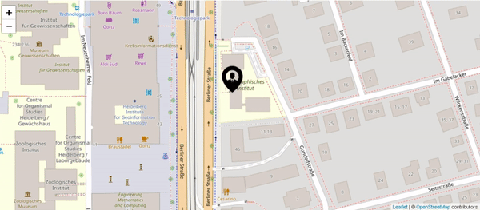

# leaflet-drift-marker

[](http://opensource.org/licenses/MIT)
[](https://www.npmjs.com/package/leaflet-drift-marker)
[](https://github.com/hugobarragon/leaflet-drift-marker/actions/workflows/ci.yml)

| Leaflet | leaflet-drift-marker | Tested with          | Install                                 |
| ------- | -------------------- | -------------------- | --------------------------------------- |
| 2.x     | 3.x (beta, ESM only) | Leaflet 2.0.0-beta.5 | `npm install leaflet-drift-marker@next` |
| 1.x     | 2.x                  | Leaflet 1.9.4        | `npm install leaflet-drift-marker@2`    |
| 1.x     | 1.x (legacy, React)  | react-leaflet 2      | `npm install leaflet-drift-marker@1`    |



**[Live demo](https://hugobarragon.github.io/leaflet-drift-marker/)** (2.x on Leaflet 1)

A Leaflet 2 marker that moves smoothly to a new position instead of jumping. Written in TypeScript and framework-agnostic, so it works with plain Leaflet, Vue, Angular and others. Ported from [Leaflet.Marker.SlideTo](https://gitlab.com/IvanSanchez/Leaflet.Marker.SlideTo).

## Versions

This README covers 3.x for Leaflet 2. For Leaflet 1, see the [2.x README](https://github.com/hugobarragon/leaflet-drift-marker/blob/v2.1.0/README.md). For many markers, use Leaflet's canvas renderer for better performance.

## Installation

```bash
npm install leaflet-drift-marker@next leaflet@beta
```

`leaflet` is a [peer dependency](https://docs.npmjs.com/cli/configuring-npm/package-json#peerdependencies).

## Usage

### With a bundler

```javascript
import { LeafletMap, TileLayer } from "leaflet";
import DriftMarker from "leaflet-drift-marker";

const map = new LeafletMap("map").setView([0, 0], 4);
new TileLayer("https://tile.openstreetmap.org/{z}/{x}/{y}.png").addTo(map);

const marker = new DriftMarker([10, 10]).addTo(map);

marker.slideTo([20, 20], {
  duration: 2000,
  keepAtCenter: true,
});
```

### In the browser without a bundler

Use a module script and an import map so `leaflet` resolves to Leaflet 2's ESM build.

```html
<link rel="stylesheet" href="https://unpkg.com/leaflet@2.0.0-beta.5/dist/leaflet.css" />
<script type="importmap">
  {
    "imports": {
      "leaflet": "https://unpkg.com/leaflet@2.0.0-beta.5/dist/leaflet.js",
      "leaflet-drift-marker": "https://unpkg.com/leaflet-drift-marker@3.0.0-beta.1/lib/index.js"
    }
  }
</script>

<div id="map" style="height: 400px"></div>
<script type="module">
  import { LeafletMap, TileLayer } from "leaflet";
  import DriftMarker from "leaflet-drift-marker";

  const map = new LeafletMap("map").setView([0, 0], 4);
  new TileLayer("https://tile.openstreetmap.org/{z}/{x}/{y}.png", {
    attribution: "&copy; OpenStreetMap contributors",
  }).addTo(map);

  const marker = new DriftMarker([0, 0]).addTo(map);
  marker.slideTo([10, 10], { duration: 1000 });
</script>
```

### Upgrading from 2.x

- Upgrade to Leaflet 2 first; 3.x does not run on Leaflet 1.
- ESM only: `require()` and the `<script>` build (`window.DriftMarker`) are gone. Use `import`.
- The deprecated `slideOptions` type is removed; use `SlideOptions`.

## API

`DriftMarker` accepts everything Leaflet's [`Marker`](https://leafletjs.com/reference.html#marker) does, and adds:

- `.slideTo(latlng, options)`: animates the marker to `latlng`. Fires `movestart` and `moveend`.
  - `options.duration` (number, required): animation length in ms.
  - `options.keepAtCenter` (boolean, optional): pans the map with the marker and locks dragging and zoom-to-point (double-click, pinch and scroll-wheel zoom) until the slide ends.
- `.slideCancel()`: stops the current slide and restores map interaction.

Calling `setLatLng` or removing the marker during a slide cancels the slide. A `duration` of 0 moves the marker straight to the target.

## Contributing

See [AGENTS.md](./AGENTS.md) for layout, commands and conventions.

## License

MIT
